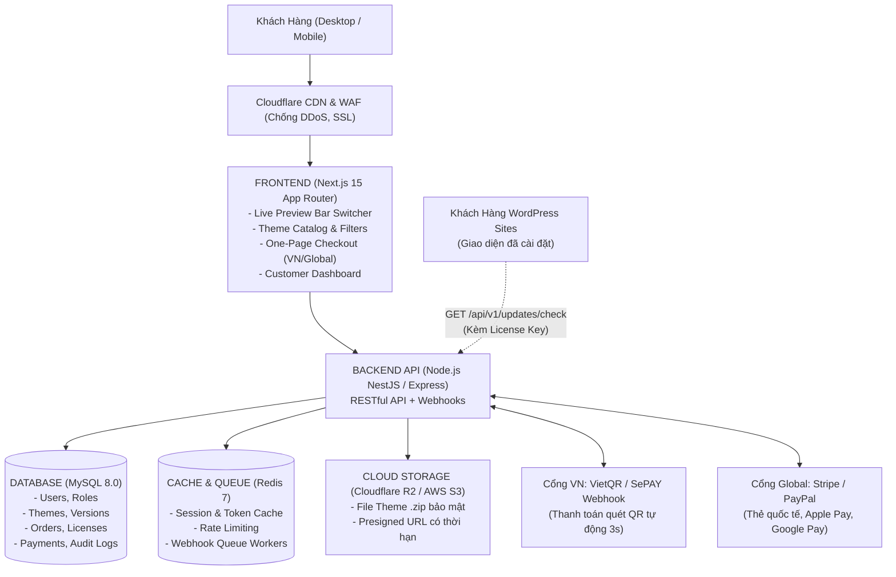

# NỀN TẢNG THƯƠNG MẠI THEME KỸ THUẬT SỐ (VIỆT NAM & TOÀN CẦU)
> **Kiến trúc Kỹ thuật Toàn diện cho Backend (BE), Frontend (FE), Cơ sở dữ liệu (MySQL) và CI/CD**

---

## 🏛️ 1. KIẾN TRÚC TỔNG THỂ HỆ THỐNG (SYSTEM ARCHITECTURE)

Hệ thống được thiết kế theo mô hình **Tách rời (Decoupled / Microservices-ready)** để đảm bảo khả năng chịu tải cao, tốc độ tải trang nhanh chuẩn Core Web Vitals, và tính bảo mật tuyệt đối cho tài nguyên số:



---

## 🗄️ 2. THIẾT KẾ CƠ SỞ DỮ LIỆU (MYSQL 8.0)

Cơ sở dữ liệu được chuẩn hóa cao (3NF), sử dụng bộ ký tự `utf8mb4` và collation `utf8mb4_unicode_ci`. Toàn bộ mã nguồn DDL khởi tạo nằm tại [`database/schema.sql`](file:///c:/Users/Ngoc%20Minh%20Kien/Downloads/instalaveis_woodmart-woocommerce_woodmart-8.6.2/woodmart/database/schema.sql).

### 2.1. Danh mục các bảng cốt lõi (Core Tables):
1. **`users`**: Quản lý tài khoản khách hàng, tác giả (author) và ban quản trị (admin).
2. **`categories`**: Danh mục ngành nghề (E-commerce, B2B, Y tế & Spa, F&B, Giáo dục, Bất động sản, Portfolio).
3. **`themes`**: Thông tin sản phẩm theme, định giá song song (VND / USD), liên kết live demo, điểm đánh giá, số lượt bán.
4. **`theme_versions`**: Quản lý các phiên bản phát hành (v1.0.0, v1.1.0...), changelog và đường dẫn file zip an toàn trên Cloud Storage.
5. **`orders`**: Thông tin đơn đặt hàng, trạng thái thanh toán, tiền tệ và địa chỉ IP.
6. **`order_items`**: Chi tiết sản phẩm trong đơn, loại bản quyền (`regular`, `agency`, `lifetime`).
7. **`licenses`**: Bảng sinh khóa bản quyền (License Key), giới hạn số lượng domain kích hoạt.
8. **`license_activations`**: Ghi nhận domain cụ thể đang kích hoạt license, hỗ trợ cơ chế thu hồi/chuyển đổi domain.
9. **`payments`**: Lưu vết chi tiết giao dịch thanh toán từ webhook VietQR, Stripe, PayPal (đảm bảo tính Idempotency).
10. **`download_logs`**: Nhật ký tải file (IP, thời gian, user agent) để phát hiện và ngăn chặn hành vi tải hàng loạt bất thường.

### 2.2. Khởi tạo Cơ sở Dữ liệu nhanh:
```bash
# Đăng nhập MySQL và import schema:
mysql -u root -p theme_marketplace < database/schema.sql
```

---

## ⚙️ 3. KIẾN TRÚC BACKEND (BE - MÔ HÌNH MVC)

Backend được xây dựng theo chuẩn **Kiến trúc MVC (Model - View - Controller + Service Layer)** trên nền tảng **Node.js (Express & TypeScript)**, đảm bảo phân tách rõ ràng trách nhiệm giữa xử lý dữ liệu, nghiệp vụ và phản hồi HTTP:

* **Cấu trúc thư mục Backend (`backend/`):**
  ```
  backend/
  ├── src/
  │   ├── config/                # Cấu hình MySQL Pool, Redis, biến môi trường (.env)
  │   │   ├── database.ts
  │   │   └── env.ts
  │   ├── models/                # [M] DATA MODELS: Truy vấn cơ sở dữ liệu MySQL
  │   │   ├── user.model.ts
  │   │   ├── category.model.ts
  │   │   ├── theme.model.ts
  │   │   ├── order.model.ts
  │   │   └── license.model.ts
  │   ├── views/                 # [V] VIEWS: Định dạng chuẩn hóa API Response envelope
  │   │   └── response.view.ts
  │   ├── controllers/           # [C] CONTROLLERS: Điều phối request/response HTTP
  │   │   ├── auth.controller.ts
  │   │   ├── theme.controller.ts
  │   │   ├── order.controller.ts
  │   │   ├── payment.controller.ts (Xử lý Webhook VietQR / SePAY)
  │   │   └── updater.controller.ts (Xử lý WordPress Auto-Updater API)
  │   ├── services/              # BUSINESS LOGIC & INTEGRATIONS
  │   │   ├── auth.service.ts    # Băm mật khẩu bcrypt, cấp phát JWT
  │   │   ├── sepay.service.ts   # Sinh mã VietQR, xác thực chữ ký Webhook
  │   │   └── license.service.ts # Thuật toán sinh License Key ngẫu nhiên
  │   ├── middlewares/           # AUTH & ERROR HANDLING
  │   │   ├── auth.middleware.ts
  │   │   └── error.middleware.ts
  │   ├── routes/                # ĐỊNH TUYẾN API (/api/v1/...)
  │   │   ├── index.ts
  │   │   ├── auth.routes.ts
  │   │   ├── theme.routes.ts
  │   │   ├── order.routes.ts
  │   │   ├── payment.routes.ts
  │   │   └── updater.routes.ts
  │   ├── app.ts                 # Cấu hình Express app, Helmet, CORS
  │   └── server.ts              # Khởi động máy chủ cổng 4000
  ├── Dockerfile
  ├── package.json
  └── tsconfig.json
  ```

### 3.1. Các API Endpoints Đã Sẵn Sàng:
* **Xác thực:** `POST /api/v1/auth/register`, `POST /api/v1/auth/login`, `GET /api/v1/auth/me`
* **Kho Theme:** `GET /api/v1/themes` (Lọc theo danh mục, builder, từ khóa, phân trang), `GET /api/v1/themes/:slug`
* **Danh mục:** `GET /api/v1/themes/categories`
* **Đơn hàng:** `POST /api/v1/orders/checkout` (Sinh mã đơn hàng & mã VietQR động), `GET /api/v1/orders/:orderNumber/status`
* **Webhook Thanh toán:** `POST /api/v1/webhooks/sepay` (Tự động kích hoạt đơn hàng & sinh License Key trong 3s)
* **WordPress Auto-Updater API:** `GET /api/v1/updater/check?license_key=xxx` (Endpoint tương thích với plugin-update-checker trên WordPress)

---

## 🖥️ 4. KIẾN TRÚC FRONTEND (FE - FEATURE-DRIVEN ARCHITECTURE)

Nhằm mục tiêu **dễ bảo trì, sửa chữa độc lập và không dẫm chân lên nhau khi nhiều người cùng làm việc**, Frontend Next.js 15 được tái cấu trúc theo mô hình **Feature-Driven (Vertical Slice Architecture)**:

```
frontend/
├── src/
│   ├── app/                   # THIN APP ROUTER (Chỉ nhận URL params và render Feature)
│   │   ├── layout.tsx         # Root Layout
│   │   ├── page.tsx           # Trang chủ (kết nối Themes Feature)
│   │   ├── preview/[slug]/    # Khung Live Preview Bar (kết nối Preview Feature)
│   │   └── checkout/          # Trang thanh toán 1 bước (kết nối Checkout Feature)
│   │
│   ├── features/              # VERTICAL SLICES (Cô lập theo từng tính năng)
│   │   ├── themes/            # Feature Theme: ThemeCard, FilterSidebar, types
│   │   │   └── components/
│   │   │       └── theme-card.tsx
│   │   ├── preview/           # Feature Live Preview: Thanh điều khiển, Responsive Switcher
│   │   │   └── components/
│   │   │       └── live-preview-bar.tsx
│   │   └── checkout/          # Feature Thanh toán: VietQRModal, Auto Polling 3s
│   │       └── components/
│   │           └── vietqr-modal.tsx
│   │
│   └── shared/                # DÙNG CHUNG TOÀN HỆ THỐNG (REUSABLE)
│       ├── stores/            # Zustand Store (Quản lý giỏ hàng, Tiền tệ VND/USD)
│       │   └── cart.store.ts
│       ├── types/             # Global Interfaces (ThemeItem, CartItem, Currency)
│       │   └── index.ts
│       └── components/        # UI components dùng chung (Button, Header, Footer)
├── Dockerfile
├── package.json
└── tsconfig.json
```

### 4.1. Lợi Ích Vượt Trội Về Mặt Bảo Trì (Maintainability):
1. **Cô lập lỗi (Zero Side-Effects):** Khi cần sửa logic quét mã VietQR, lập trình viên chỉ cần can thiệp vào `src/features/checkout/`, hoàn toàn không ảnh hưởng đến giao diện xem Theme hay Live Preview.
2. **Trang mỏng (Thin Pages):** Các tệp `page.tsx` trong thư mục `src/app/` chỉ dài từ 15 đến 30 dòng, đóng vai trò kết nối logic, cực kỳ dễ đọc và debug.
3. **Phân chia 2 lập trình viên FE không xung đột:**
   * **Thành viên 04:** Làm việc toàn quyền trong `src/features/themes/` và `src/features/preview/`.
   * **Thành viên 05:** Làm việc toàn quyền trong `src/features/checkout/` và `src/features/licenses/`.
   * Cả hai sử dụng chung Store và Types trong `src/shared/`.

---

## 🔄 5. QUY TRÌNH CI/CD & DEVOPS

Quy trình tự động hóa được thiết lập thông qua **GitHub Actions** tại [`.github/workflows/ci-cd.yml`](file:///c:/Users/Ngoc%20Minh%20Kien/Downloads/instalaveis_woodmart-woocommerce_woodmart-8.6.2/woodmart/.github/workflows/ci-cd.yml).

### 5.1. Luồng Hoạt Động (Pipeline Stages):
1. **Continuous Integration (CI):**
   * Kích hoạt khi có `push` hoặc `pull_request` vào nhánh `main` hoặc `develop`.
   * Khởi động Docker container dịch vụ MySQL và Redis thử nghiệm.
   * Chạy tự động: Linting (`npm run lint`), Type-checking (`tsc --noEmit`), và Unit Tests.
2. **Docker Packaging:**
   * Tự động build Docker Image cho Backend và Frontend.
   * Đẩy hình ảnh đóng gói lên **GitHub Container Registry (GHCR)** có gắn thẻ phiên bản Git SHA.
3. **Continuous Deployment (CD):**
   * Kết nối SSH an toàn vào máy chủ VPS Production.
   * Tự động kéo mã nguồn mới (`git pull origin main`), cập nhật containers (`docker compose up -d`), và chạy database migrations không gián đoạn dịch vụ.

### 5.2. Các Biến Bí Mật Cần Cấu Hình Trên GitHub (Repository Secrets):
* `SERVER_HOST`: Địa chỉ IP máy chủ Production.
* `SERVER_USER`: Tên người dùng SSH (ví dụ: `deploy` hoặc `root`).
* `SSH_PRIVATE_KEY`: Khóa SSH Private Key dùng để xác thực không cần mật khẩu.
* `SERVER_PORT`: Cổng SSH (mặc định: `22`).

---

## 🚀 6. HƯỚNG DẪN KHỞI CHẠY MÔI TRƯỜNG PHÁT TRIỂN (QUICKSTART)

### Yêu cầu hệ thống:
* Docker & Docker Compose (v2.20+)
* Node.js v20+ & npm

### Bước 1: Sao chép tệp cấu hình môi trường
```bash
cp .env.example .env
```
*(Chỉnh sửa thông số tài khoản ngân hàng VietQR, khóa Stripe/PayPal trong tệp `.env` nếu cần)*

### Bước 2: Khởi chạy toàn bộ hạ tầng bằng Docker Compose
```bash
docker compose up -d
```
Lệnh trên sẽ tự động khởi động:
* **MySQL 8.0**: Cổng `3306` (Tự động nạp bảng từ `database/schema.sql`).
* **Redis 7**: Cổng `6379`.
* **Backend API**: Cổng `4000` (`http://localhost:4000`).
* **Frontend Next.js**: Cổng `3000` (`http://localhost:3000`).

### Bước 3: Kiểm tra trạng thái hệ thống
```bash
docker compose ps
docker compose logs -f
```

---

## 📚 7. BỘ TÀI LIỆU DỰ ÁN LIÊN QUAN

* 🤝 [**`TEAM_COLLABORATION_MATRIX.md`**](./TEAM_COLLABORATION_MATRIX.md) - **Ma trận kết nối 5 thành viên**: Sơ đồ luồng dữ liệu, hợp đồng API giữa các vai trò, cơ chế bàn giao công việc và xử lý khi bị block.
* 🛠️ [**`DEV_SETUP_REQUIREMENTS.md`**](./DEV_SETUP_REQUIREMENTS.md) - **Danh sách cần cài đặt (Prerequisites)**: Hướng dẫn chi tiết mọi phần mềm, công cụ, VS Code extensions và tài khoản sandbox cần cài cho từng thành viên.
* 🚀 [**`GIT_WORKFLOW_GUIDE.md`**](./GIT_WORKFLOW_GUIDE.md) - **Quy chuẩn Git & Đẩy code**: Hướng dẫn quy trình chuẩn chỉ khi thêm, sửa, xóa tính năng, quy ước đặt tên nhánh và tạo Pull Request.
* 📖 [**`INSTALLATION_GUIDE.md`**](./INSTALLATION_GUIDE.md) - **Hướng dẫn cài đặt chi tiết**: Triển khai hạ tầng kỹ thuật (Docker, BE, FE, MySQL) & Hướng dẫn cài đặt/import demo theme Woodmart trên WordPress.
* 📄 [**`CEO_STRATEGY.md`**](./CEO_STRATEGY.md) - Chiến lược kinh doanh, định vị thị trường, pháp lý và mô hình đa doanh thu.
* 🗺️ [**`SITEMAP.md`**](./SITEMAP.md) - Bản đồ sitemap chi tiết, cấu trúc phân hệ và luồng trải nghiệm khách hàng.
* 🚀 [**`ROADMAP.md`**](./ROADMAP.md) - Lộ trình thực thi 4 giai đoạn, các mốc tiến độ và quản trị rủi ro.

---

## 👥 8. PHÂN CHIA CÔNG VIỆC CHO 5 THÀNH VIÊN DỰ ÁN (TEAM WORKSPACE)

Dự án được phân chia thành 5 vai trò độc lập, có tài liệu nhiệm vụ, backlog và tiêu chí nghiệm thu chi tiết:

1. 📘 [**`README_MEMBER_1_DEVOPS_DATABASE.md`**](./README_MEMBER_1_DEVOPS_DATABASE.md)  
   **Thành viên 01 (Lead DevOps & Database):** Quản trị MySQL 8.0, Redis, Docker Compose, CI/CD GitHub Actions, Nginx, SSL và Cloudflare R2 / S3.
2. 📘 [**`README_MEMBER_2_BE_CORE_CATALOG.md`**](./README_MEMBER_2_BE_CORE_CATALOG.md)  
   **Thành viên 02 (Backend Core & Catalog):** Xây dựng NestJS/Express API, JWT Auth & RBAC, Quản lý kho Theme, Bộ lọc đa ngành, Swagger Docs.
3. 📘 [**`README_MEMBER_3_BE_PAYMENT_LICENSING.md`**](./README_MEMBER_3_BE_PAYMENT_LICENSING.md)  
   **Thành viên 03 (Backend Payment & Licensing):** Cổng VietQR tự động (SePAY) 3 giây, Stripe/PayPal, Sinh License Key, API WordPress Auto-Updater.
4. 📘 [**`README_MEMBER_4_FE_STOREFRONT_PREVIEW.md`**](./README_MEMBER_4_FE_STOREFRONT_PREVIEW.md)  
   **Thành viên 04 (Frontend Storefront & UX):** Giao diện Next.js 15, Trang chủ, Bộ lọc Theme đa tiêu chí, Khung Live Preview Bar (Desktop/Tablet/Mobile).
5. 📘 [**`README_MEMBER_5_FE_CHECKOUT_PORTAL.md`**](./README_MEMBER_5_FE_CHECKOUT_PORTAL.md)  
   **Thành viên 05 (Frontend Checkout & Customer Portal):** Thanh toán 1 bước (One-page Checkout), Popup VietQR động, Customer Dashboard (`/my-account`), Admin CMS (`/admin`).
