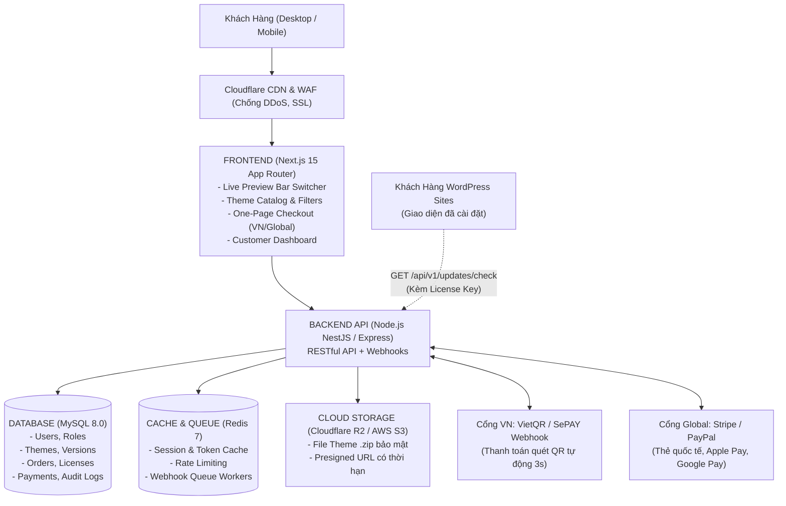

# NỀN TẢNG THƯƠNG MẠI THEME KỸ THUẬT SỐ (VIỆT NAM & TOÀN CẦU)
> **Kiến trúc Kỹ thuật Toàn diện cho Backend (BE), Frontend (FE), Cơ sở dữ liệu (MySQL) và CI/CD**

---

## 🏛️ 1. KIẾN TRÚC TỔNG THỂ HỆ THỐNG (SYSTEM ARCHITECTURE)

Hệ thống được thiết kế theo mô hình **Tách rời (Decoupled / Microservices-ready)** để đảm bảo khả năng chịu tải cao, tốc độ tải trang nhanh chuẩn Core Web Vitals, và tính bảo mật tuyệt đối cho tài nguyên số:



---

## 🗄️ 2. THIẾT KẾ CƠ SỞ DỮ LIỆU (MYSQL 8.0)

Cơ sở dữ liệu được chuẩn hóa cao (3NF), sử dụng bộ ký tự `utf8mb4` và collation `utf8mb4_unicode_ci`. Toàn bộ mã nguồn DDL khởi tạo nằm tại [`database/schema.sql`](file:///c:/Users/Ngoc%20Minh%20Kien/Downloads/instalaveis_woodmart-woocommerce_woodmart-8.6.2/woodmart/database/schema.sql).

### 2.1. Danh mục các bảng cốt lõi (Core Tables):
1. **`users`**: Quản lý tài khoản khách hàng, tác giả (author) và ban quản trị (admin).
2. **`categories`**: Danh mục ngành nghề (E-commerce, B2B, Y tế & Spa, F&B, Giáo dục, Bất động sản, Portfolio).
3. **`themes`**: Thông tin sản phẩm theme, định giá song song (VND / USD), liên kết live demo, điểm đánh giá, số lượt bán.
4. **`theme_versions`**: Quản lý các phiên bản phát hành (v1.0.0, v1.1.0...), changelog và đường dẫn file zip an toàn trên Cloud Storage.
5. **`orders`**: Thông tin đơn đặt hàng, trạng thái thanh toán, tiền tệ và địa chỉ IP.
6. **`order_items`**: Chi tiết sản phẩm trong đơn, loại bản quyền (`regular`, `agency`, `lifetime`).
7. **`licenses`**: Bảng sinh khóa bản quyền (License Key), giới hạn số lượng domain kích hoạt.
8. **`license_activations`**: Ghi nhận domain cụ thể đang kích hoạt license, hỗ trợ cơ chế thu hồi/chuyển đổi domain.
9. **`payments`**: Lưu vết chi tiết giao dịch thanh toán từ webhook VietQR, Stripe, PayPal (đảm bảo tính Idempotency).
10. **`download_logs`**: Nhật ký tải file (IP, thời gian, user agent) để phát hiện và ngăn chặn hành vi tải hàng loạt bất thường.

### 2.2. Khởi tạo Cơ sở Dữ liệu nhanh:
```bash
# Đăng nhập MySQL và import schema:
mysql -u root -p theme_marketplace < database/schema.sql
```

---

## ⚙️ 3. KIẾN TRÚC BACKEND (BE)

* **Công nghệ khuyến nghị:** **Node.js (NestJS / TypeScript)** hoặc **Express.js** với kiến trúc phân tầng (Controller ➔ Service ➔ Repository).
* **Cấu trúc thư mục Backend (`backend/`):**
  ```
  backend/
  ├── src/
  │   ├── modules/
  │   │   ├── auth/              # JWT, Google OAuth, Refresh Tokens
  │   │   ├── themes/            # CRUD Themes, lọc ngành nghề, upload bản mới
  │   │   ├── orders/            # Tạo đơn, tính giá VND/USD, giỏ hàng
  │   │   ├── payments/          # Xử lý Webhook VietQR (SePAY), Stripe, PayPal
  │   │   ├── licenses/          # Sinh Key, kích hoạt Domain, xác thực API
  │   │   ├── updater/           # API Cập nhật tự động cho WordPress Client
  │   │   └── storage/           # Tạo link tải có thời hạn Cloudflare R2 / S3
  │   ├── common/                # Guards, Interceptors, Filters, DTOs
  │   └── main.ts
  ├── Dockerfile
  ├── package.json
  └── tsconfig.json
  ```

### 3.1. Các API Endpoints Quan Trọng:
* **Xác thực & Người dùng:**
  * `POST /api/v1/auth/register` & `POST /api/v1/auth/login`
  * `GET /api/v1/user/downloads` (Lấy danh sách theme đã mua và link tải)
* **Khám phá Theme:**
  * `GET /api/v1/themes` (Bộ lọc theo danh mục, builder, giá, tìm kiếm full-text)
  * `GET /api/v1/themes/:slug` (Chi tiết theme, screenshots, thông số kỹ thuật)
* **Thanh toán & Đơn hàng:**
  * `POST /api/v1/orders/checkout` (Khởi tạo đơn hàng, trả về mã QR VietQR hoặc Stripe Session)
  * `POST /api/v1/webhooks/sepay` (Webhook nhận thông báo chuyển khoản ngân hàng tự động)
  * `POST /api/v1/webhooks/stripe` (Webhook xác nhận thanh toán thẻ quốc tế)
* **License & Auto-Update Engine (Dành cho WordPress Client):**
  * `POST /api/v1/licenses/activate` (Kích hoạt theme trên domain của khách)
  * `GET /api/v1/updater/check?license_key=xxx&version=8.6.2` (Kiểm tra bản cập nhật mới)
  * `GET /api/v1/updater/download?license_key=xxx` (Lấy file zip update sau khi xác thực license hợp lệ)

---

## 🖥️ 4. KIẾN TRÚC FRONTEND (FE)

* **Công nghệ khuyến nghị:** **Next.js 15 (React 19, App Router)** kết hợp **Tailwind CSS v4** và **TypeScript**.
* **Cấu trúc thư mục Frontend (`frontend/`):**
  ```
  frontend/
  ├── src/
  │   ├── app/
  │   │   ├── (store)/           # Trang chủ, Catalog, Danh mục
  │   │   ├── theme/[slug]/      # Trang chi tiết Theme tối ưu chuyển đổi
  │   │   ├── preview/[slug]/    # Giao diện Live Preview Bar + Responsive Iframe
  │   │   ├── checkout/          # Trang thanh toán 1 bước (One-page Checkout)
  │   │   ├── my-account/        # Dashboard khách: Tải theme, Quản lý License
  │   │   └── docs/              # Trung tâm tài liệu & hướng dẫn cài đặt
  │   ├── components/            # UI components (Header, ThemeCard, DeviceSwitcher...)
  │   ├── hooks/                 # Custom React hooks
  │   └── stores/                # Quản lý trạng thái (Zustand: Cart, Currency, Lang)
  ├── Dockerfile
  └── package.json
  ```

### 4.1. Tính Năng Frontend Độc Quyền:
1. **Live Preview Switcher Bar:** Khung iframe phía trên cho phép người dùng click nhanh chuyển đổi giữa 3 chế độ xem: **Desktop**, **Tablet**, **Mobile** kèm nút "Mua Ngay" luôn cố định.
2. **One-Page Checkout Siêu Tốc:** Tự động phát hiện vị trí địa lý của khách hàng:
   * Nếu khách ở Việt Nam: Hiển thị tiền tệ VND và mã VietQR thanh toán tự động.
   * Nếu khách quốc tế: Hiển thị tiền tệ USD và form thẻ tín dụng Stripe / Apple Pay / PayPal.

---

## 🔄 5. QUY TRÌNH CI/CD & DEVOPS

Quy trình tự động hóa được thiết lập thông qua **GitHub Actions** tại [`.github/workflows/ci-cd.yml`](file:///c:/Users/Ngoc%20Minh%20Kien/Downloads/instalaveis_woodmart-woocommerce_woodmart-8.6.2/woodmart/.github/workflows/ci-cd.yml).

### 5.1. Luồng Hoạt Động (Pipeline Stages):
1. **Continuous Integration (CI):**
   * Kích hoạt khi có `push` hoặc `pull_request` vào nhánh `main` hoặc `develop`.
   * Khởi động Docker container dịch vụ MySQL và Redis thử nghiệm.
   * Chạy tự động: Linting (`npm run lint`), Type-checking (`tsc --noEmit`), và Unit Tests.
2. **Docker Packaging:**
   * Tự động build Docker Image cho Backend và Frontend.
   * Đẩy hình ảnh đóng gói lên **GitHub Container Registry (GHCR)** có gắn thẻ phiên bản Git SHA.
3. **Continuous Deployment (CD):**
   * Kết nối SSH an toàn vào máy chủ VPS Production.
   * Tự động kéo mã nguồn mới (`git pull origin main`), cập nhật containers (`docker compose up -d`), và chạy database migrations không gián đoạn dịch vụ.

### 5.2. Các Biến Bí Mật Cần Cấu Hình Trên GitHub (Repository Secrets):
* `SERVER_HOST`: Địa chỉ IP máy chủ Production.
* `SERVER_USER`: Tên người dùng SSH (ví dụ: `deploy` hoặc `root`).
* `SSH_PRIVATE_KEY`: Khóa SSH Private Key dùng để xác thực không cần mật khẩu.
* `SERVER_PORT`: Cổng SSH (mặc định: `22`).

---

## 🚀 6. HƯỚNG DẪN KHỞI CHẠY MÔI TRƯỜNG PHÁT TRIỂN (QUICKSTART)

### Yêu cầu hệ thống:
* Docker & Docker Compose (v2.20+)
* Node.js v20+ & npm

### Bước 1: Sao chép tệp cấu hình môi trường
```bash
cp .env.example .env
```
*(Chỉnh sửa thông số tài khoản ngân hàng VietQR, khóa Stripe/PayPal trong tệp `.env` nếu cần)*

### Bước 2: Khởi chạy toàn bộ hạ tầng bằng Docker Compose
```bash
docker compose up -d
```
Lệnh trên sẽ tự động khởi động:
* **MySQL 8.0**: Cổng `3306` (Tự động nạp bảng từ `database/schema.sql`).
* **Redis 7**: Cổng `6379`.
* **Backend API**: Cổng `4000` (`http://localhost:4000`).
* **Frontend Next.js**: Cổng `3000` (`http://localhost:3000`).

### Bước 3: Kiểm tra trạng thái hệ thống
```bash
docker compose ps
docker compose logs -f
```

---

## 📚 7. BỘ TÀI LIỆU DỰ ÁN LIÊN QUAN

* 🚀 [**`GIT_WORKFLOW_GUIDE.md`**](./GIT_WORKFLOW_GUIDE.md) - **Quy chuẩn Git & Đẩy code**: Hướng dẫn quy trình chuẩn chỉ khi thêm, sửa, xóa tính năng, quy ước đặt tên nhánh và tạo Pull Request.
* 📖 [**`INSTALLATION_GUIDE.md`**](./INSTALLATION_GUIDE.md) - **Hướng dẫn cài đặt chi tiết**: Triển khai hạ tầng kỹ thuật (Docker, BE, FE, MySQL) & Hướng dẫn cài đặt/import demo theme Woodmart trên WordPress.
* 📄 [**`CEO_STRATEGY.md`**](./CEO_STRATEGY.md) - Chiến lược kinh doanh, định vị thị trường, pháp lý và mô hình đa doanh thu.
* 🗺️ [**`SITEMAP.md`**](./SITEMAP.md) - Bản đồ sitemap chi tiết, cấu trúc phân hệ và luồng trải nghiệm khách hàng.
* 🚀 [**`ROADMAP.md`**](./ROADMAP.md) - Lộ trình thực thi 4 giai đoạn, các mốc tiến độ và quản trị rủi ro.

---

## 👥 8. PHÂN CHIA CÔNG VIỆC CHO 5 THÀNH VIÊN DỰ ÁN (TEAM WORKSPACE)

Dự án được phân chia thành 5 vai trò độc lập, có tài liệu nhiệm vụ, backlog và tiêu chí nghiệm thu chi tiết:

1. 📘 [**`README_MEMBER_1_DEVOPS_DATABASE.md`**](./README_MEMBER_1_DEVOPS_DATABASE.md)  
   **Thành viên 01 (Lead DevOps & Database):** Quản trị MySQL 8.0, Redis, Docker Compose, CI/CD GitHub Actions, Nginx, SSL và Cloudflare R2 / S3.
2. 📘 [**`README_MEMBER_2_BE_CORE_CATALOG.md`**](./README_MEMBER_2_BE_CORE_CATALOG.md)  
   **Thành viên 02 (Backend Core & Catalog):** Xây dựng NestJS/Express API, JWT Auth & RBAC, Quản lý kho Theme, Bộ lọc đa ngành, Swagger Docs.
3. 📘 [**`README_MEMBER_3_BE_PAYMENT_LICENSING.md`**](./README_MEMBER_3_BE_PAYMENT_LICENSING.md)  
   **Thành viên 03 (Backend Payment & Licensing):** Cổng VietQR tự động (SePAY) 3 giây, Stripe/PayPal, Sinh License Key, API WordPress Auto-Updater.
4. 📘 [**`README_MEMBER_4_FE_STOREFRONT_PREVIEW.md`**](./README_MEMBER_4_FE_STOREFRONT_PREVIEW.md)  
   **Thành viên 04 (Frontend Storefront & UX):** Giao diện Next.js 15, Trang chủ, Bộ lọc Theme đa tiêu chí, Khung Live Preview Bar (Desktop/Tablet/Mobile).
5. 📘 [**`README_MEMBER_5_FE_CHECKOUT_PORTAL.md`**](./README_MEMBER_5_FE_CHECKOUT_PORTAL.md)  
   **Thành viên 05 (Frontend Checkout & Customer Portal):** Thanh toán 1 bước (One-page Checkout), Popup VietQR động, Customer Dashboard (`/my-account`), Admin CMS (`/admin`).
