# KIẾN TRÚC THÔNG TIN & SITEMAP HOÀN CHỈNH (INFORMATION ARCHITECTURE)

Tài liệu này xác định cấu trúc toàn bộ các trang, luồng tương tác của người dùng (User Flows), và bản đồ sitemap chi tiết để chuyển đổi Woodmart thành nền tảng phân phối Theme kỹ thuật số đa lĩnh vực (Việt Nam & Toàn cầu).

---

## 1. SƠ ĐỒ HỆ THỐNG TRỰC QUAN (SITEMAP DIAGRAM)

```mermaid
graph TD
    Root["Trang Chủ (Homepage)"]
    
    %% Main Branches
    Root --> Explore["Khám Phá Theme (Theme Catalog)"]
    Root --> SingleTheme["Trang Chi Tiết Theme (Single Product)"]
    Root --> Services["Dịch Vụ Đi Kèm (Services)"]
    Root --> Membership["Gói Hội Viên (All-Access Pass)"]
    Root --> HelpCenter["Trung Tâm Hỗ Trợ (Docs & Help)"]
    Root --> UserAccount["Tài Khoản Khách Hàng (My Account)"]
    Root --> CheckoutFlow["Quy Trình Mua Hàng (Checkout Flow)"]
    Root --> Legal["Pháp Lý & Tin Cậy (Legal & Trust)"]

    %% Explore Sub
    Explore --> CatEcom["E-Commerce / Bán Hàng"]
    Explore --> CatB2B["Doanh Nghiệp & Dịch Vụ"]
    Explore --> CatHealth["Y Tế, Spa & Thẩm Mỹ"]
    Explore --> CatEd["Giáo Dục & Khóa Học"]
    Explore --> CatTravel["Du Lịch, Khách Sạn & F&B"]
    Explore --> CatCreative["Portfolio, Blog & Tin Tức"]

    %% Single Theme Sub
    SingleTheme --> LivePreview["Thanh Live Preview (Demo Bar + Iframe)"]
    SingleTheme --> Docs["Tài Liệu Cài Đặt (Theme Docs)"]

    %% Checkout Flow Sub
    CheckoutFlow --> Cart["Giỏ Hàng Nhanh (Side Cart)"]
    CheckoutFlow --> OnePageCheckout["Thanh Toán 1 Trang (One-page Checkout)"]
    OnePageCheckout --> GatewayVN["Cổng VN: VietQR / MoMo / ZaloPay"]
    OnePageCheckout --> GatewayGlobal["Cổng Quốc Tế: Stripe / PayPal / Apple Pay"]
    OnePageCheckout --> OrderSuccess["Trang Nhận Hàng: Download File + License Key"]

    %% User Account Sub
    UserAccount --> MyDownloads["Tệp Đã Mua & Phiên Bản Mới"]
    UserAccount --> MyLicenses["Quản Lý License Keys & Domain"]
    UserAccount --> MyTickets["Quản Lý Yêu Cầu Hỗ Trợ"]
    UserAccount --> Invoices["Hóa Đơn & Xuất VAT"]

    %% Vendor Marketplace (Phase 4)
    Root -.-> VendorPortal["Cổng Tác Giả (Author Portal - Phase 4)"]
    VendorPortal -.-> VendorDashboard["Dashboard Doanh Thu & Rút Tiền"]
    VendorPortal -.-> UploadTheme["Gửi Theme Kiểm Duyệt"]
```

---

## 2. CẤU TRÚC CHI TIẾT TỪNG PHÂN HỆ TRANG

### 2.1. Trang Chủ (Homepage - `https://domain.com/`)
Mục tiêu: Gây ấn tượng mạnh mẽ trong 3 giây đầu tiên, khẳng định chất lượng và sự đa dạng của kho theme.

* **Header & Topbar:**
  * Bộ chuyển đổi ngôn ngữ (Tiếng Việt 🇻🇳 / English 🇺🇸).
  * Bộ chuyển đổi tiền tệ tự động theo IP (VND ₫ / USD $).
  * Thanh tìm kiếm thông minh (Live AJAX Search với gợi ý tag, danh mục, hình ảnh thu nhỏ).
  * Nút "Đăng nhập / Đăng ký" và "Giỏ hàng nhanh" (Offcanvas Mini-Cart).
* **Hero Section:**
  * Tiêu đề: *"Kho Giao Diện Chuẩn SEO, Tối Ưu Tốc Độ Cho Mọi Ngành Nghề"*.
  * Bộ lọc nhanh ngay tại Hero: Chọn Ngành nghề ➔ Chọn Nền tảng (WordPress / WooCommerce / Elementor / Shopify) ➔ Nút Tìm Kiếm.
  * Huy hiệu bảo chứng: *100% Mã sạch, Cập nhật trọn đời, Kích hoạt tức thì, Hỗ trợ 24/7*.
* **Danh mục Nổi bật (Featured Categories):** Thẻ icon/hình minh họa trực quan cho 6 nhóm ngành lớn.
* **Theme Bán chạy nhất (Best Selling Themes):** Tab chuyển đổi "Mới nhất", "Bán chạy", "Ưu đãi tuần".
* **Banner Gói Hội Viên (All-Access Pass CTA):** Tiết kiệm 80% chi phí với gói truy cập toàn bộ kho giao diện.
* **Đánh giá từ Khách hàng & Agency (Social Proof & Testimonials):** Logo các đối tác và review thực tế từ lập trình viên.
* **Chính sách cam kết:** Quét virus sạch 100%, Hỗ trợ cài đặt trong 2 giờ, Hoàn tiền nếu lỗi.

---

### 2.2. Trang Danh Mục & Khám Phá Theme (Theme Catalog - `/themes/`)
Mục tiêu: Giúp khách hàng tìm ra theme chính xác theo nhu cầu chỉ với 2-3 cú click chuột.

* **Bộ lọc nâng cao bên Sidebar / Top Filter:**
  * **Lĩnh vực (Industry):** Bán lẻ, Bất động sản, Spa/Làm đẹp, F&B, Giáo dục, Tin tức, Portfolio,...
  * **Trình dựng trang (Page Builder):** Elementor, Gutenberg, WooCommerce Native, WPBakery, Bricks Builder.
  * **Tính năng đặc biệt:** Đa ngôn ngữ (WPML/Polylang), Tương thích thiết bị di động (100% Responsive), Tối ưu Core Web Vitals (Speed Score 95+), RTL Ready.
  * **Mức giá:** Miễn phí, Dưới 500k, 500k - 1tr, Trên 1tr (hoặc < $30, $30 - $60, > $60).
  * **Sắp xếp:** Phổ biến nhất, Đánh giá cao nhất, Mới cập nhật, Giá tăng/giảm dần.
* **Thẻ Theme (Theme Grid Card):**
  * Ảnh đại diện mockup sắc nét.
  * Tên Theme + Phiên bản hiện tại (VD: v8.6.2).
  * Số lượng lượt bán (Sales count) & Số sao đánh giá (Rating).
  * Giá tiền (VND hoặc USD tùy vị trí địa lý).
  * Hai nút hành động nhanh: **"Xem Demo"** (mở Live Preview) và **"Xem Chi Tiết"**.

---

### 2.3. Trang Chi Tiết Theme (Theme Single Page - `/theme/{slug}/`)
Mục tiêu: Đạt tỷ lệ chuyển đổi (CR) tối đa từ người xem thành người mua.

* **Khu vực Trực quan (Visual Area):**
  * Slider ảnh chụp màn hình độ phân giải cao các trang quan trọng: Trang chủ, Chi tiết sản phẩm, Giỏ hàng, Mobile view.
  * Nút nổi bật nhất trang: **"XEM LIVE DEMO TRỰC TIẾP"** (mở giao diện demo responsive).
* **Bảng Lựa Chọn Bản Quyền (License Selector & Pricing Box):**
  * **Regular License:** Dùng cho 1 website | Hỗ trợ 6 tháng | Cập nhật miễn phí.
  * **Agency License:** Dùng cho 5 website | Hỗ trợ 12 tháng ưu tiên.
  * **Gia hạn hỗ trợ (Add-on):** Gia hạn hỗ trợ thêm 12 tháng (+299.000đ hoặc +$19).
  * **Dịch vụ cài đặt hộ (Add-on Checkbox):** Cài đặt trọn gói lên hosting của khách (+399.000đ hoặc +$29).
  * Nút **"MUA NGAY (BUY NOW)"** và **"THÊM VÀO GIỎ HÀNG"**.
* **Thông số Kỹ thuật (Technical Specifications Table):**
  * Ngày phát hành, Ngày cập nhật mới nhất.
  * Phiên bản WordPress tối thiểu, Phiên bản PHP khuyến nghị (PHP 8.1 - 8.3).
  * Danh sách plugin đi kèm.
  * Tệp đính kèm: Theme zip, Child-theme zip, Dummy data XML, Tài liệu hướng dẫn PDF/HTML.
* **Nhật ký thay đổi (Changelog):** Lịch sử các phiên bản từ quá khứ đến hiện tại.
* **Đánh giá & Bình luận (Verified Buyer Reviews & Comments):** Chỉ cho phép khách đã mua hàng đánh giá sao.

---

### 2.4. Thanh Điều Khiển Demo (Live Preview Frame - `/preview/{slug}/`)
Mục tiêu: Giữ chân khách hàng và cung cấp nút bấm mua ngay bất cứ lúc nào họ đang trải nghiệm demo.

* **Top Navigation Bar (Cố định phía trên cùng):**
  * Logo nền tảng (click về trang chủ).
  * Dropdown chọn các phiên bản Demo (Home Modern, Home Minimal, Home Marketplace...).
  * 3 Icon chuyển đổi thiết bị xem trước: **Desktop** (100%), **Tablet** (768px), **Mobile** (375px).
  * Nút xanh nổi bật: **"MUA THEME NÀY (BUY NOW)"** - click chuyển ngay vào giỏ hàng.
  * Nút "X" (Đóng frame để xem full màn hình URL demo).
* **Khu vực Nội dung:**
  * Iframe hiển thị website demo thực tế với tốc độ tải nhanh, chặn thanh admin bar của WordPress.

---

### 2.5. Luồng Thanh Toán Tối Giản (Streamlined Checkout Flow)
Mục tiêu: Thanh toán dưới 30 giây, không có rào cản thông tin vận chuyển vật lý.

* **Trang Thanh Toán 1 Bước (One-Page Frictionless Checkout - `/checkout/`):**
  * Chỉ yêu cầu 3 trường thông tin:
    1. Họ và tên (Full Name).
    2. Địa chỉ Email (để nhận License Key và Link tải).
    3. Số điện thoại (tùy chọn, để hỗ trợ qua Zalo khi cần).
  * **Khu vực Chọn Cổng Thanh Toán Động (Dynamic Payment Gateways):**
    * *Dành cho khách hàng tại Việt Nam (IP Việt Nam / Tiền tệ VND):*
      * **VietQR Chuyển khoản tự động (SePAY):** Hiển thị mã QR ngân hàng có sẵn nội dung chuyển khoản và số tiền. Khách quét app ngân hàng bất kỳ, hệ thống bắt webhook và kích hoạt đơn sau 3 giây.
      * **Ví điện tử MoMo / ZaloPay.**
    * *Dành cho khách hàng Quốc tế (IP Global / Tiền tệ USD):*
      * **Stripe:** Thẻ tín dụng/ghi nợ quốc tế (Visa, Mastercard, AMEX), Apple Pay, Google Pay.
      * **PayPal:** Thanh toán qua tài khoản PayPal hoặc thẻ quốc tế.
* **Trang Nhận Hàng Tức Thì (Instant Download & Order Completed - `/checkout/order-received/`):**
  * Bảng tệp tải về: Link tải tệp Theme `.zip` và Child theme bản mới nhất (có bảo vệ link).
  * **License Key:** Dãy khóa bản quyền riêng biệt được sinh tự động.
  * Mã QR kích hoạt nhanh hoặc hướng dẫn 3 bước cài đặt.
  * Nút "Tải hóa đơn PDF" / "Yêu cầu hóa đơn đỏ VAT (cho công ty VN)".

---

### 2.6. Trung Tâm Tài Khoản Khách Hàng (Customer Dashboard - `/my-account/`)
* **Trang Tổng Quan (Dashboard):** Lời chào, tổng số theme đã sở hữu, thông báo cập nhật mới.
* **Tải Xuống (My Downloads):** Danh sách toàn bộ các theme đã mua kèm liên kết tải trực tiếp phiên bản mới nhất bất kỳ lúc nào.
* **Quản Lý Bản Quyền (License Manager):**
  * Xem License Key tương ứng với từng theme.
  * Xem danh sách Domain đang kích hoạt (Domain Binding).
  * Nút "Hủy kích hoạt domain cũ (Deactivate)" để khách chuyển theme sang domain mới.
* **Yêu Cầu Hỗ Trợ (Support Tickets):** Gửi yêu cầu trợ giúp kỹ thuật, theo dõi tiến độ xử lý của kỹ thuật viên.
* **Lịch Sử Đơn Hàng & Hóa Đơn (Order History & Invoices):** Tải biên lai, hóa đơn điện tử cho từng đơn hàng.

---

### 2.7. Trung Tâm Tài Liệu & Hỗ Trợ (Documentation & Help Center - `/docs/`)
* **Tài liệu hướng dẫn (Step-by-Step Docs):**
  * Hướng dẫn cài đặt Theme từ A-Z (Import demo 1-click).
  * Hướng dẫn tùy biến Header, Footer, Font chữ, Màu sắc theo thương hiệu.
  * Tối ưu tốc độ website (Cài đặt plugin cache, nén ảnh WebP).
* **Video Hướng Dẫn (Video Tutorials):** Series video Youtube nhúng trực tiếp thao tác thực tế.
* **Cộng đồng & Trợ giúp Trực tiếp:** Liên kết nhóm Zalo hỗ trợ khách hàng, Telegram Support Bot.

---

### 2.8. Các Trang Pháp Lý & Niềm Tin (Trust & Legal Pages)
* `/about-us/` (Về chúng tôi & Đội ngũ phát triển)
* `/license-terms/` (Chi tiết các loại giấy phép bản quyền)
* `/refund-policy/` (Chính sách hoàn tiền minh bạch cho sản phẩm số)
* `/terms-of-service/` (Điều khoản dịch vụ)
* `/privacy-policy/` (Chính sách bảo mật dữ liệu GDPR & Nghị định 13/VN)
* `/contact/` (Liên hệ, form gửi tin nhắn và thông tin công ty)
