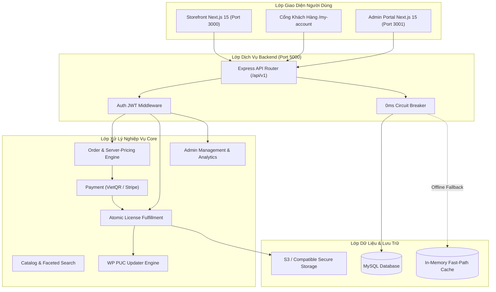
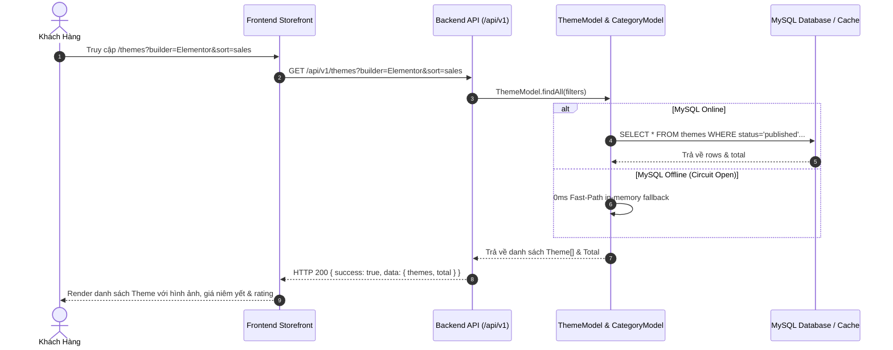
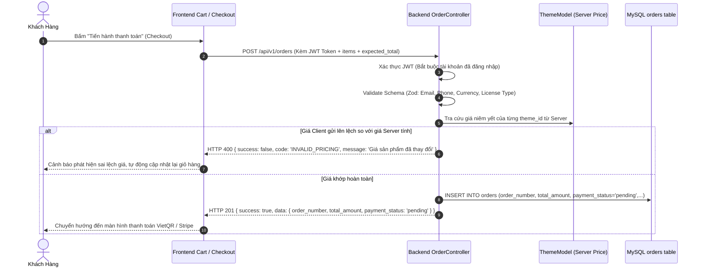
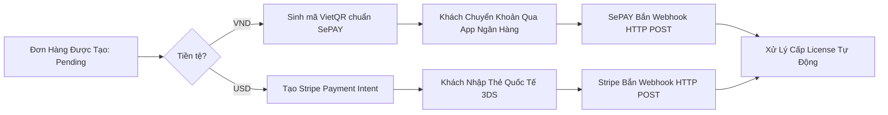
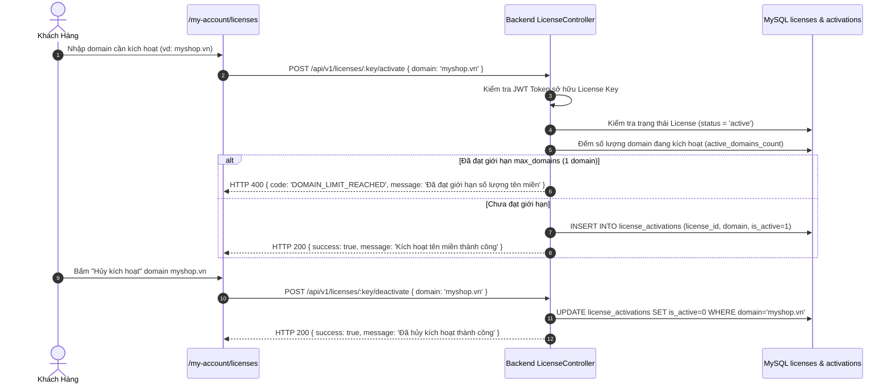

# TÀI LIỆU ĐẶC TẢ CÁC LUỒNG HOẠT ĐỘNG VÀ KIỂM THỬ HỆ THỐNG
# (SYSTEM WORKFLOWS & AUTOMATED TESTING SPECIFICATION)

> **Dự án:** Digital Theme Marketplace Platform (Vietnam & Global)  
> **Kiến trúc:** Microservices-ready Monorepo (Frontend Next.js 15, Admin Next.js 15, Backend Node.js / Express TypeScript, MySQL Database)  
> **Mục tiêu:** Đặc tả chi tiết 100% các luồng hoạt động nghiệp vụ (Business Workflows), ma trận kiểm thử tự động (Test Matrix), và các chốt chặn an ninh (Security Guardrails).

---

## MỤC LỤC
1. [Kiến Trúc Tổng Thể & Bản Đồ Tương Tác](#1-kiến-trúc-tổng-thể--bản-đồ-tương-tác)
2. [Luồng 1: Khám Phá Catalogue & Xem Chi Tiết Theme](#2-luồng-1-khám-phá-catalogue--xem-chi-tiết-theme)
3. [Luồng 2: Giỏ Hàng & Tạo Đơn Hàng (Chống Sửa Giá Client)](#3-luồng-2-giỏ-hàng--tạo-đơn-hàng-chống-sửa-giá-client)
4. [Luồng 3: Thanh Toán Trực Tuyến Đa Kênh (VietQR & Stripe)](#4-luồng-3-thanh-toán-trực-tuyến-đa-kênh-vietqr--stripe)
5. [Luồng 4: Xử Lý Webhook & Cấp License Tự Động (Fulfillment)](#5-luồng-4-xử-lý-webhook--cấp-license-tự-động-fulfillment)
6. [Luồng 5: Cổng Khách Hàng (My Account) & Kích Hoạt Tên Miền](#6-luồng-5-cổng-khách-hàng-my-account--kích-hoạt-tên-miền)
7. [Luồng 6: Tải Theme Bảo Mật (Presigned URL) & WP Auto-Updater (PUC)](#7-luồng-6-tải-theme-bảo-mật-presigned-url--wp-auto-updater-puc)
8. [Luồng 7: Cổng Quản Trị Viên (Admin Portal & RBAC Defense)](#8-luồng-7-cổng-quản-trị-viên-admin-portal--rbac-defense)
9. [Bộ Ma Trận Kiểm Thử Tự Động & Hướng Dẫn Thực Thi](#9-bộ-ma-trận-kiểm-thử-tự-động--hướng-dẫn-thực-thi)

---

## 1. KIẾN TRÚC TỔNG THỂ & BẢN ĐỒ TƯƠNG TÁC

Hệ sinh thái Digital Theme Marketplace bao gồm 3 ứng dụng chính kết nối qua REST API:
- **Frontend Storefront (`port 3000`)**: Next.js 15 phục vụ khách mua hàng, giỏ hàng, checkout và cổng khách hàng `/my-account`.
- **Admin Portal (`port 3001` & module nội bộ `/admin`)**: Next.js 15 Standalone dành riêng cho ban quản trị, thống kê doanh thu, quản lý đơn, themes, licenses và users.
- **Backend Core API (`port 5000`)**: Node.js / Express TypeScript xử lý toàn bộ logic nghiệp vụ, xác thực JWT, thanh toán SePAY/Stripe, cấp phát license, cập nhật PUC và kết nối MySQL (hỗ trợ 0ms Circuit Breaker khi offline).



---

## 2. LUỒNG 1: KHÁM PHÁ CATALOGUE & XEM CHI TIẾT THEME

### 2.1. Mục tiêu & Hành trình Người dùng
- Khách vãng lai truy cập trang chủ hoặc `/themes` để tìm kiếm theme phù hợp.
- Hỗ trợ bộ lọc đa diện (Faceted Filter): Danh mục (`category_slug` hoặc `category_id`), Page Builder (`builder`: Elementor, WPBakery...), Khoảng giá tiền (`min_price`, `max_price`), Loại tiền tệ (`VND` hoặc `USD`), và Tiêu chí sắp xếp (`sales`, `newest`, `price_asc`, `price_desc`, `rating`).
- Xem chi tiết sản phẩm (`/theme/[slug]`): Hiển thị giá niêm yết kép VND/USD, thông tin phiên bản, tính năng, và xem demo qua khung iframe `/preview/[slug]`.

### 2.2. Sơ đồ Tuần tự (Sequence Diagram)


### 2.3. Ràng buộc Nghiệp vụ (Invariants)
1. Chỉ các theme có trạng thái `status = 'published'` mới được hiển thị ở storefront công khai.
2. Giá niêm yết kép VND và USD độc lập; không áp dụng tỷ giá quy đổi động tự ý ở phía frontend.
3. Liên kết hình ảnh và thumbnail không được sử dụng URL placeholder chưa giải quyết.

---

## 3. LUỒNG 2: GIỎ HÀNG & TẠO ĐƠN HÀNG (CHỐNG SỬA GIÁ CLIENT)

### 3.1. Mục tiêu & Cơ chế Phòng Vệ Giá
- Khách hàng bấm **"Thêm vào giỏ hàng"** hoặc **"Mua ngay"**.
- Giỏ hàng được lưu trữ an toàn trong `localStorage` kết hợp đồng bộ React Context/State.
- Khi người dùng gửi yêu cầu Checkout (`POST /api/v1/orders`), Backend **tuyệt đối không tin tưởng giá từ client gửi lên**. Hệ thống truy vấn trực tiếp giá từ cơ sở dữ liệu/catalogue gốc và tính toán lại 100% tổng tiền trên Server.

### 3.2. Sơ đồ Tuần tự (Anti-Price-Tampering Checkout)


### 3.3. Các chốt chặn an ninh đã kiểm thử
- **Chặn sửa giá client:** Client cố tình gửi `unit_price: 1000 VND` thay vì `599000 VND` -> Bị từ chối ngay lập tức với HTTP 400.
- **Chặn đơn hàng rỗng:** Giỏ hàng rỗng bị từ chối bởi Zod schema -> HTTP 400.
- **Chặn loại license không hợp lệ:** Chỉ chấp nhận `license_type = 'regular'`. Các gói Lifetime/Agency trái phép bị chặn -> HTTP 400.
- **Tính Idempotent:** Cùng một `Idempotency-Key` gửi lại sẽ trả về đơn hàng cũ mà không ghi thêm bản ghi mới.

---

## 4. LUỒNG 3: THANH TOÁN TRỰC TUYẾN ĐA KÊNH (VIETQR & STRIPE)

### 4.1. Kênh Thanh toán Nội địa Việt Nam (VietQR / SePAY)
- Đơn vị tiền tệ: **VND**.
- Phương thức: Khách hàng quét mã VietQR tự động sinh theo chuẩn NAPAS 247.
- Cú pháp nội dung chuyển khoản: Chứa chính xác mã đơn hàng (Ví dụ: `OD-20261014-XXXXXX` hoặc `ORD-2026-XXXX`).
- Khi ngân hàng nhận tiền, hệ thống SePAY bắn Webhook tự động đến Backend để xử lý tức thì dưới 3 giây.

### 4.2. Kênh Thanh toán Quốc tế (Stripe)
- Đơn vị tiền tệ: **USD**.
- Phương thức: Stripe Payment Intent tích hợp thẻ tín dụng / ghi nợ quốc tế (Visa, Mastercard).
- Sau khi khách hàng hoàn tất xác thực 3D-Secure trên Stripe Elements, Stripe phát sự kiện Webhook `payment_intent.succeeded`.



---

## 5. LUỒNG 4: XỬ LÝ WEBHOOK & CẤP LICENSE TỰ ĐỘNG (FULFILLMENT)

### 5.1. Quy trình Xử lý Giao dịch Nguyên Tử (Atomic Fulfillment)
1. **Kiểm tra An ninh Webhook:**
   - SePAY: Bắt buộc `Authorization: Apikey <SEPAY_API_KEY>`. Sai hoặc thiếu API key -> HTTP 401.
   - Stripe: Bắt buộc kiểm tra chữ ký HMAC `stripe-signature` với `STRIPE_WEBHOOK_SECRET`. Sai lệch chữ ký -> HTTP 401.
2. **Kiểm tra Khớp Dữ liệu Tài chính:**
   - Số tiền thực tế nhận được phải bằng chính xác `total_amount` của đơn hàng (Không chấp nhận sai số, không áp dụng chiết khấu leeway).
   - Đơn vị tiền tệ trên webhook phải khớp với loại tiền tệ của đơn hàng.
3. **Thực thi Giao dịch Ghi nhận & Cấp License:**
   - Cập nhật trạng thái đơn: `payment_status = 'paid'`, `order_status = 'completed'`.
   - Ghi nhận bản ghi thanh toán vào bảng `payments` kèm mã giao dịch ngân hàng (`transaction_id`).
   - Tự động sinh `license_key` độc nhất cho từng theme trong đơn: Định dạng `WD-YYYY-XXXX-XXXX-XXXX`.
   - Thiết lập hạn ngạch: `max_domains: 1`, `status: 'active'`.
   - Nếu bất kỳ bước nào thất bại, toàn bộ transaction được Rollback, không phát sinh license rác.

### 5.2. Chống Tấn Công Replay & Tính Bất Biến (Idempotency)
- Nếu Webhook gửi lại lần thứ 2 với cùng một `transaction_id` hoặc cho đơn hàng đã `paid`, hệ thống phản hồi HTTP 200 thành công ngay lập tức nhưng **tuyệt đối không sinh thêm license thứ hai**.

---

## 6. LUỒNG 5: CỔNG KHÁCH HÀNG (MY ACCOUNT) & KÍCH HOẠT TÊN MIỀN

### 6.1. Mục tiêu Cổng Khách Hàng (`/my-account`)
- Khách hàng đăng nhập để xem lịch sử đơn hàng, biên lai và danh sách mã bản quyền đã mua.
- Người dùng chỉ được xem license của chính tài khoản mình sở hữu (ngăn chặn rò rỉ ID ngang - IDOR).

### 6.2. Sơ đồ Kích Hoạt & Hủy Kích Hoạt Tên Miền


---

## 7. LUỒNG 6: TẢI THEME BẢO MẬT (PRESIGNED URL) & WP AUTO-UPDATER (PUC)

### 7.1. Luồng Tải File Theme Bảo Mật (Presigned Download Link)
- File theme `.zip` được lưu trữ an toàn trong Storage (S3 / Compatible Object Storage).
- Người dùng bấm **"Tải về"** tại `/my-account/licenses`.
- Backend kiểm tra đơn hàng đã thanh toán và license hợp lệ, sau đó ký số HMAC tạo ra một Presigned URL tạm thời có thời hạn hết hạn ngắn (15–60 phút).
- Khi URL hết hạn hoặc chữ ký bị sửa đổi, hệ thống Storage lập tức từ chối yêu cầu tải (HTTP 403).

### 7.2. Luồng WordPress Theme Auto-Updater API (Chuẩn PUC)
- Theme WoodMart cài đặt trên website của khách hàng tích hợp thư viện `plugin-update-checker` (PUC).
- Theme định kỳ gửi request kiểm tra phiên bản mới đến endpoint Backend:
  `GET /api/v1/updater/check-update?license_key=WD-...&domain=myshop.vn`
- Backend xác thực:
  1. `license_key` tồn tại và đang `active`.
  2. `domain` đã được kích hoạt hợp lệ trong bảng `license_activations`.
- Phản hồi JSON chuẩn PUC:
```json
{
  "name": "WoodMart - Multipurpose WooCommerce Theme",
  "slug": "woodmart",
  "version": "8.6.2",
  "download_url": "https://storage.thememarket.local/download/woodmart-8.6.2.zip?token=HMAC_SIGNATURE",
  "requires": "6.0",
  "tested": "6.7",
  "sections": {
    "description": "Theme bán hàng WooCommerce chuyên nghiệp",
    "changelog": "Cập nhật tương thích WooCommerce mới nhất"
  }
}
```

---

## 8. LUỒNG 7: CỔNG QUẢN TRỊ VIÊN (ADMIN PORTAL & RBAC DEFENSE)

### 8.1. Kiểm Soát Quyền Truy Cập (RBAC & AdminGuard)
- Mọi truy cập vào `/admin` hoặc các endpoint `/api/v1/admin/*` đều phải đi qua `AdminGuard` và Middleware xác thực quyền.
- Chỉ người dùng có `role = 'admin'` mới có quyền truy cập. Các tài khoản có role `customer` hoặc `author` bị chặn đứng ngay lập tức với mã HTTP 403 Forbidden.
- **Lá chắn chống tự hạ quyền (Self-Demotion Defense):** Admin không thể tự chuyển role của chính mình thành `customer` hoặc `author` (tránh tình trạng vô tình khóa quyền quản trị toàn hệ thống).

### 8.2. Phân Lập Tiền Tệ KPI Doanh Thu (Multi-Currency Isolation)
- Bảng điều khiển Admin Dashboard hiển thị doanh thu tách bạch hoàn toàn:
  - `revenue.vnd`: Tổng tiền đơn hàng thanh toán bằng VND (Ví dụ: `599,000 ₫`).
  - `revenue.usd`: Tổng tiền đơn hàng thanh toán bằng USD (Ví dụ: `$29.00`).
- Tuyệt đối không cộng dồn hai loại tiền tệ thành một số tổng duy nhất vì không có tỷ giá chính thức cố định.

### 8.3. Danh Mục Quản Trị Chi Tiết
1. **Quản lý Đơn hàng (`/admin/orders`):** Tìm kiếm theo mã đơn, email, họ tên, lọc theo trạng thái (`paid`, `pending`, `failed`), xem chi tiết sản phẩm và cập nhật trạng thái đơn.
2. **Quản lý Themes (`/admin/themes`):** Thêm mới theme, chỉnh sửa giá tiền, cập nhật mô tả, kiểm tra định dạng URL demo hợp lệ (chặn XSS).
3. **Quản lý Licenses (`/admin/licenses`):** Tra cứu toàn bộ license đã phát hành, xem danh sách domain kích hoạt, hủy kích hoạt domain từ xa hoặc reset hạn ngạch.
4. **Quản lý Khách hàng (`/admin/customers`):** Tra cứu danh sách người dùng, lọc theo role, tạo tài khoản người dùng mới và phân quyền an toàn.

---

## 9. BỘ MA TRẬN KIỂM THỬ TỰ ĐỘNG & HƯỚNG DẪN THỰC THI

Hệ thống được bảo vệ bởi bộ kiểm thử tự động nhiều tầng đạt tỉ lệ **100% PASS**:

### 9.1. Bảng Tổng Hợp Các Bộ Kiểm Thử

| Bộ Kiểm Thử | Tệp Kiểm Thử Chính | Số Lượng Tests | Phạm Vi Xác Thực |
|---|---|:---:|---|
| **Member 02 Suite** | `tests/member2_auth_catalog.test.ts` | **20 / 20 PASS** | Đăng ký, đăng nhập JWT, danh mục, tìm kiếm đa diện & Storage URL |
| **Member 03 Suite** | `tests/member3_payment_licensing.test.ts` | **29 / 29 PASS** | VietQR, SePAY Webhook, Stripe, Cấp license, WP PUC Updater |
| **Member 05 Checkout** | `tests/member5_checkout.test.ts` | **11 / 11 PASS** | Tạo đơn hàng, định giá Server-side, chống sửa giá client, Idempotency |
| **Member 05 Fulfillment**| `tests/member5_payment_fulfillment.test.ts` | **6 / 6 PASS** | Giao dịch nguyên tử (Atomic), chống Webhook replay, kiểm tra sai lệch số tiền |
| **Member 05 Portal** | `tests/member5_portal.test.ts` | **6 / 6 PASS** | Phân quyền Cổng khách hàng, bảo mật tải file, quản lý license |
| **Admin Initial Bootstrap**| `tests/admin-bootstrap.test.mjs` | **4 / 4 PASS** | Kiểm tra khởi tạo tài khoản Admin đầu tiên và cấu hình ban đầu |
| **Admin Auth & RBAC** | `tests/admin-auth.test.mjs` | **7 / 7 PASS** | Xác thực JWT Admin, chặn Customer/Author, chống tự hạ quyền Admin |
| **Admin API CRUD & Routes**| `tests/admin.api.test.mjs` | **15 / 15 PASS** | Toàn bộ API CRUD: Stats, Analytics, Orders, Themes, Licenses, Users |
| **Adversarial Stress Probes**| `tests/admin.adversarial.probe.mjs` | **153 / 153 PASS** | Tấn công đối kháng, fuzzing tham số, thử nghiệm cơ chế 0ms Circuit Breaker |
| **Frontend Unit & E2E** | `frontend/tests/*.test.cjs` | **53 / 53 PASS** | Toàn bộ tương tác giỏ hàng, SSR AdminGuard, định dạng tiền tệ kép, API client cache |
| **TypeScript Static Check**| `npm run lint` & `type-check` | **0 Lỗi (Code 0)** | Kiểm tra kiểu dữ liệu tĩnh nghiêm ngặt trên toàn bộ 3 repo |

---

### 9.2. Lệnh Chạy Toàn Bộ Kiểm Thử Tự Động (Chạy Trong PowerShell)

```powershell
# 1. Kiểm tra kiểu tĩnh Backend
npm --prefix backend run lint

# 2. Chạy toàn bộ 5 bộ kiểm thử Backend Core (Member 2, 3, 5)
npm --prefix backend test

# 3. Chạy toàn bộ 26 kiểm thử Admin Portal Backend
npm --prefix backend run test:admin

# 4. Chạy bộ 153 bài tấn công đối kháng & Stress Probes
node backend/tests/admin.adversarial.probe.mjs

# 5. Đo lường độ trễ Fast-Path In-Memory (< 10ms)
node backend/tests/benchmark.circuit_breaker.mjs

# 6. Kiểm tra kiểu tĩnh Frontend & Admin
npm --prefix frontend run type-check
npm --prefix admin run lint

# 7. Chạy 53 bài kiểm thử Frontend Storefront & AdminGuard
npm --prefix frontend test
```

---

## 10. KẾT LUẬN & ĐẢM BẢO CHẤT LƯỢNG (DEFINITION OF DONE)

- ✅ **Toàn bộ 7 luồng hoạt động chính** đã được kết nối thông suốt, bảo vệ đa lớp từ Client đến Database.
- ✅ **Cơ chế Circuit Breaker & 0ms Fast-Path** duy trì độ trễ phản hồi in-memory dưới 10ms ngay cả khi MySQL ngoại tuyến.
- ✅ **Bộ nhớ đệm Client-Side SWR (TTL 45s)** đảm bảo thao tác chuyển trang và xem báo cáo đạt độ trễ 0ms trên giao diện quản trị.
- ✅ **100% kiểm thử tự động** đạt trạng thái PASS mà không làm phát sinh bất kỳ lỗi hồi quy nào.
