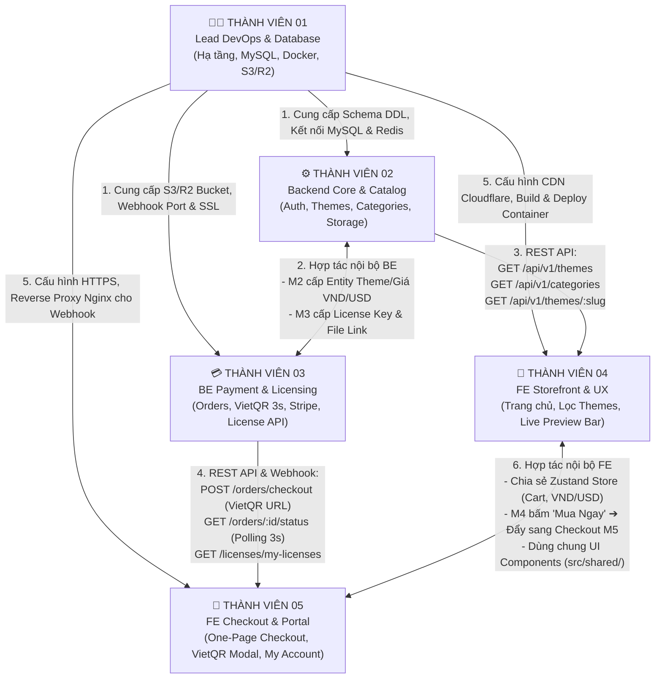

# 🤝 MA TRẬN PHỐI HỢP & KẾT NỐI GIỮA 5 THÀNH VIÊN (TEAM COLLABORATION MATRIX)

> **Mục tiêu:** Định nghĩa rõ ràng luồng dữ liệu (Data Flow), hợp đồng giao tiếp (API Contracts), và cách 5 thành viên chuyển giao công việc cho nhau mà không bị tắc nghẽn (block) tiến độ.

---

## 🗺️ 1. SƠ ĐỒ KẾT NỐI TỔNG THỂ (COLLABORATION FLOWCHART)



---

## 🔗 2. CHI TIẾT TỪNG CẶP KẾT NỐI (PEER-TO-PEER INTEGRATION)

---

### CẶP 1: THÀNH VIÊN 01 (DevOps) ⟷ THÀNH VIÊN 02 & 03 (Backend)
* **Luồng kết nối:** Hạ tầng ➔ Mã nguồn Backend
* **Giao tiếp cụ thể:**
  1. **Thành viên 01 bàn giao:**
     * File [`database/schema.sql`](./database/schema.sql) đã nạp sẵn 10 bảng vào MySQL container.
     * Thông tin kết nối nội bộ trong Docker: `DB_HOST=mysql`, `REDIS_HOST=redis`.
     * Tài khoản truy cập Cloudflare R2 / AWS S3 (`R2_ACCESS_KEY`, `R2_BUCKET_NAME`) để upload file `.zip`.
  2. **Thành viên 02 & 03 yêu cầu lại:**
     * Khi cần thêm cột mới hoặc bảng mới, bàn giao lại file migration cho Thành viên 01 để đánh chỉ mục (Index) tối ưu.
     * Cung cấp các lệnh kiểm thử `npm run test` để Thành viên 01 cấu hình vào file CI/CD GitHub Actions.

---

### CẶP 2: THÀNH VIÊN 02 (BE Core) ⟷ THÀNH VIÊN 03 (BE Payment & License)
* **Luồng kết nối:** Hai kỹ sư Backend phối hợp nội bộ
* **Giao tiếp cụ thể:**
  1. **Chia sẻ Database & Models:** Cả hai cùng dùng chung kết nối MySQL Pool trong `backend/src/config/database.ts`.
  2. **Luồng dữ liệu tạo đơn:**
     * Khi khách đặt hàng, Thành viên 03 (Orders) cần đọc bảng `themes` do Thành viên 02 quản lý để kiểm tra xem theme có đang mở bán (`status = 'published'`) và lấy đúng giá tiền (`price_vnd`, `price_usd`).
  3. **Luồng dữ liệu tải file:**
     * Khi khách hàng vào xem danh sách tải về (My Downloads), Thành viên 02 gọi hàm kiểm tra License từ Thành viên 03 để đảm bảo License còn hợp lệ (`status = 'active'`) mới sinh link tải có thời hạn (Presigned URL 30 phút).

---

### CẶP 3: THÀNH VIÊN 02 (BE Core) ⟷ THÀNH VIÊN 04 (FE Storefront)
* **Luồng kết nối:** Dữ liệu Sản phẩm ➔ Trải nghiệm Người dùng
* **Hợp đồng API (API Contract):**
  | Endpoint | Phương thức | Thành viên 02 trả về | Thành viên 04 sử dụng vào đâu |
  | :--- | :---: | :--- | :--- |
  | `/api/v1/themes/categories` | `GET` | Danh sách 7 ngành nghề kèm icon và slug | Mega Menu trên Header và bộ lọc Sidebar |
  | `/api/v1/themes` | `GET` | Mảng theme có phân trang, lọc theo category, builder, giá tiền | Lưới sản phẩm Trang chủ và trang Danh mục |
  | `/api/v1/themes/:slug` | `GET` | Chi tiết theme, screenshots, tech specs, changelog | Trang chi tiết Theme (`/theme/[slug]`) |
  | `/api/v1/themes/:slug/demo`| `GET` | URL live demo gốc của theme | Nhúng vào Iframe của thanh Live Preview Bar |

---

### CẶP 4: THÀNH VIÊN 03 (BE Payment) ⟷ THÀNH VIÊN 05 (FE Checkout & Portal)
* **Luồng kết nối:** Quy trình Thanh toán Siêu tốc & Quản trị Khách hàng
* **Hợp đồng API (API Contract):**
  | Endpoint | Phương thức | Thành viên 03 cung cấp | Thành viên 05 xây dựng giao diện |
  | :--- | :---: | :--- | :--- |
  | `/api/v1/orders/checkout` | `POST` | Trả về `orderNumber` và link ảnh `vietQrUrl` | Mở popup `VietQrModal` hiển thị mã QR kèm đồng hồ đếm ngược |
  | `/api/v1/orders/:orderNumber/status` | `GET` | Trả về trạng thái `payment_status` (`pending` hoặc `paid`) | FE tự động Polling mỗi 3 giây; khi `paid` thì tự động chuyển sang trang Hoàn tất |
  | `/api/v1/user/licenses` | `GET` | Danh sách License Keys và danh sách domain đã bind | Trang Quản lý Bản quyền trong `/my-account` |
  | `/api/v1/licenses/deactivate` | `POST` | Hủy liên kết domain cũ | Nút "Hủy kích hoạt domain" để khách chuyển site |

---

### CẶP 5: THÀNH VIÊN 04 (FE Storefront) ⟷ THÀNH VIÊN 05 (FE Checkout & Portal)
* **Luồng kết nối:** Hai kỹ sư Frontend phối hợp trải nghiệm liền mạch
* **Cơ chế chia sẻ nội bộ Frontend:**
  1. **Chia sẻ Quản lý trạng thái (Zustand Store):**
     * Cả hai cùng sử dụng tệp [`frontend/src/shared/stores/cart.store.ts`](./frontend/src/shared/stores/cart.store.ts).
     * Khi khách hàng lướt xem trang của **Thành viên 04** (Trang chủ, Chi tiết theme, hoặc thanh Live Preview Bar) và bấm nút **"Mua Ngay"** ➔ Theme được nạp vào Giỏ hàng.
     * Người dùng được chuyển hướng trực tiếp sang trang `/checkout` do **Thành viên 05** phụ trách.
  2. **Đồng bộ Tiền tệ (VND / USD):**
     * Nút bấm đổi tiền tệ trên Header của Thành viên 04 sẽ thay đổi biến `currency` trong Store chung.
     * Khi chuyển sang trang Checkout của Thành viên 05, hệ thống tự động đổi phương thức thanh toán tương ứng (chọn VietQR cho VND, chọn Stripe cho USD).
  3. **Tái sử dụng Design System:** Cả 2 cùng sử dụng các component nút bấm, modal, form input trong `src/shared/components/ui/` để giao diện toàn bộ website đồng nhất 100%.

---

### CẶP 6: THÀNH VIÊN 01 (DevOps) ⟷ THÀNH VIÊN 04 & 05 (Frontend)
* **Luồng kết nối:** Hạ tầng Mạng ➔ Đóng gói Giao diện
* **Giao tiếp cụ thể:**
  1. Thành viên 01 cấu hình Nginx Reverse Proxy trỏ domain chính `yourdomain.com` vào Frontend container (cổng 3000) và `api.yourdomain.com` vào Backend container (cổng 4000).
  2. Thành viên 01 cấu hình Cloudflare CDN để nén và cache hình ảnh mockup của theme, giúp trang của Thành viên 04 đạt điểm Google PageSpeed 95+.

---

## ⏱️ 3. KỊCH BẢN MẪU: KHI 1 KHÁCH MUA THEME THÌ 5 NGƯỜI PHỐI HỢP RA SAO?

```
[BƯỚC 1] Khách vào web xem theme & Live Preview
         ↳ Giao diện do TV4 dựng, gọi API Catalog do TV2 viết.

[BƯỚC 2] Khách ưng ý và bấm nút "MUA NGAY" trên thanh Live Preview
         ↳ TV4 đẩy sản phẩm vào Zustand Store ➔ chuyển sang trang /checkout của TV5.

[BƯỚC 3] Khách điền Tên + Email và chọn Quét VietQR
         ↳ Giao diện TV5 gọi API POST /orders/checkout của TV3 ➔ hiển thị mã QR VietQR.

[BƯỚC 4] Khách mở app ngân hàng quét mã chuyển tiền
         ↳ Ngân hàng bắn Webhook vào server ➔ Nginx của TV1 chuyển tiếp an toàn vào API của TV3.

[BƯỚC 5] TV3 kiểm tra đúng tiền trong 3 giây
         ↳ Cập nhật DB MySQL, sinh License Key ngẫu nhiên và lưu vào bảng licenses.

[BƯỚC 6] Màn hình TV5 tự động nhảy sang trang Order Received
         ↳ Khách bấm nút "Tải file .zip" ➔ TV2 tạo link S3 presigned do TV1 cấu hình cho khách tải.
```

---

## 🎯 4. NGUYÊN TẮC GIẢI QUYẾT TẮC NGHẼN (UNBLOCKING RULES)

1. **Làm việc theo Hợp đồng API trước (Contract-First / Mock Data):**
   * Nếu Backend (TV2, TV3) chưa code xong API, Frontend (TV4, TV5) **không được ngồi chờ**.
   * FE tự định nghĩa file `mock-data.ts` dựa trên tài liệu DTO để dựng xong giao diện trước. Khi BE xong API chỉ cần trỏ endpoint là chạy ngay.
2. **Kênh trao đổi nhanh:**
   * Tạo nhóm Zalo/Slack chung cho cả 5 người.
   * Khi thay đổi cấu trúc bảng DB hoặc đổi tên trường API, người sửa bắt buộc phải thông báo ngay lập tức vào nhóm để đồng đội cập nhật code.
3. **Daily Sync 10 phút:**
   * Mỗi đầu ngày họp nhanh 10 phút trả lời 3 câu:
     * *Hôm qua tôi đã làm xong gì?*
     * *Hôm nay tôi sẽ làm gì?*
     * *Tôi có đang bị vướng (block) bởi ai không?*
